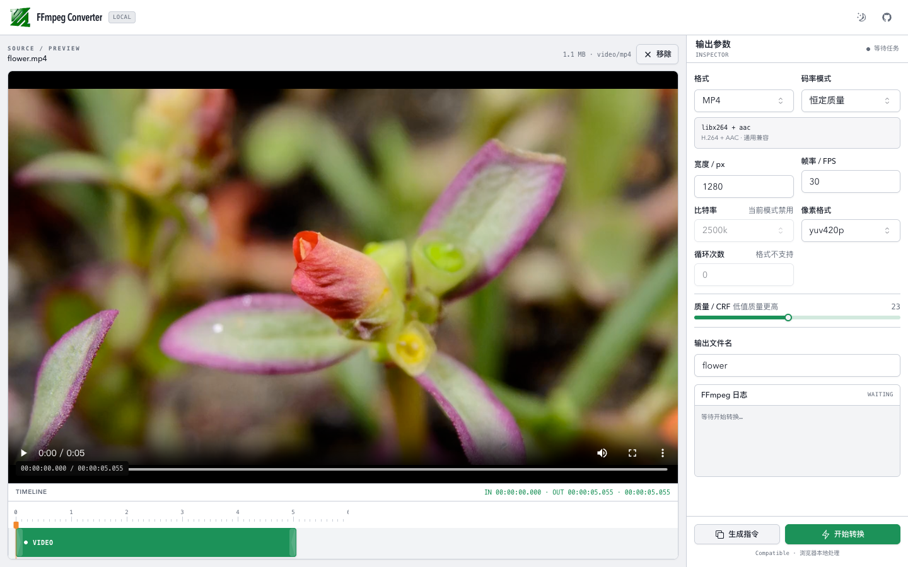

# FFmpeg Converter

[简体中文](./README-ZH.md)

A browser-local workbench for converting, trimming, and compressing video. Source files never leave your device: all transcoding runs inside a Web Worker with [ffmpeg.wasm](https://ffmpegwasm.netlify.app/).



## Features

- 11 output formats: MP4, WEBM, MOV, MKV, AVI, GIF, WEBP, FLV, MPG, OGV, and WMV
- Draggable, zoomable video timeline and live preview powered by [React Timeline Editor](https://github.com/xzdarcy/react-timeline-editor)
- Resolution, frame rate, rate control, codec-specific quality, loop, and pixel format controls
- Capability-aware parameter linkage: unsupported combinations are disabled or rejected before execution
- Copyable native FFmpeg command generation
- Compact single-page `100vh` editor with persistent Light / Dark mode
- Same-origin bundled FFmpeg core with no runtime dependency on a third-party CDN
- Stable Compatible core that avoids Multi-thread worker stalls seen in some browsers
- Live progress, persistent logs, error recovery, and task cancellation
- Automatic cleanup of input and output files in FFmpeg's virtual filesystem

## Output capability matrix

The application does not rely on FFmpeg defaults inferred from file extensions. Every output format uses an explicit profile verified against the bundled Compatible core:

| Output | Video / image codec | Audio codec | Rate control |
| --- | --- | --- | --- |
| MP4, MOV | libx264 | AAC | CRF or target bitrate, mutually exclusive |
| MKV | libx264 | Opus | CRF or target bitrate, mutually exclusive |
| WEBM | libvpx VP8 | Opus | CRF or target bitrate, mutually exclusive |
| AVI | MPEG-4 Part 2 | MP3 | Target bitrate |
| FLV | Sorenson Spark | MP3 | Target bitrate |
| MPG | MPEG-2 Video | MP2 | Target bitrate; frame rate limited to 24/25/30/50/60 |
| OGV | Theora | Vorbis | Theora quality or target bitrate |
| WMV | Windows Media Video 8 | WMA | Target bitrate |
| GIF | GIF + palettegen/paletteuse | None | No bitrate/CRF; loop control supported |
| WEBP | libwebp_anim | None | WebP quality; no generic CRF |

Pixel format choices come from each encoder's actual capabilities, with unstable combinations removed for this WASM build. WEBM uses the verified VP8 path because VP9 can trigger a WASM memory fault in the current Single-thread core.

## Local development

Requirements: Node.js 20+ and pnpm 9+.

```bash
pnpm install
pnpm dev
```

Open the root URL printed by Vite. The project has no secondary application routes. Vite copies the FFmpeg core from local dependencies into the production bundle, so no CDN or Cross-Origin Isolation headers are required.

## Quality gates

```bash
pnpm test
pnpm lint
pnpm checkbuild
pnpm audit --prod
```

- `test`: validates all 11 output profiles, mutually exclusive parameters, invalid combinations, and filename handling
- `lint`: runs ESLint with warnings treated as failures
- `checkbuild`: runs the TypeScript project build, then creates the production bundle
- `audit --prod`: checks production dependencies for known vulnerabilities

## Usage

1. Select or drag in a local video.
2. Optionally drag the Timeline clip or its trim handles to select a range.
3. Choose an output format and adjust its supported parameters.
4. Select **Generate command** to inspect the command, or **Start conversion** to run it.
5. The browser loads the FFmpeg core on demand and downloads the result when conversion finishes.

## Privacy and performance boundaries

- Video data only enters the current page's memory and FFmpeg's virtual filesystem.
- The project loads no analytics and sends neither source files nor conversion parameters to an application server.
- ffmpeg.wasm is significantly slower than native FFmpeg; use a desktop tool for large files or batch processing.
- WebAssembly has an approximately 2 GB file/memory boundary, with the practical limit depending on browser and device memory.
- The FFmpeg core is approximately 31 MB. It is downloaded only when conversion begins and reused for the lifetime of the page.

## Stack

- React 18 + TypeScript
- Vite 5
- React Timeline Editor
- React Hook Form + Zod
- Tailwind CSS + Radix UI
- ffmpeg.wasm 0.12
- Vitest

## Browser notes

The application defaults to the Single-thread Compatible core. It is slower than native FFmpeg, but more stable in browsers and does not require `SharedArrayBuffer` or Cross-Origin Isolation. The log panel remains visible throughout core initialization, virtual filesystem writes, encoding, and output generation.

## Demo

- [Bilibili demo](https://www.bilibili.com/video/BV1KMvTe5ExN/)
- [YouTube demo](https://www.youtube.com/watch?v=SDm7EcHQV_k)
